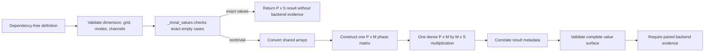
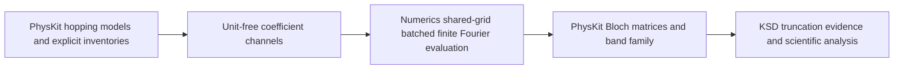
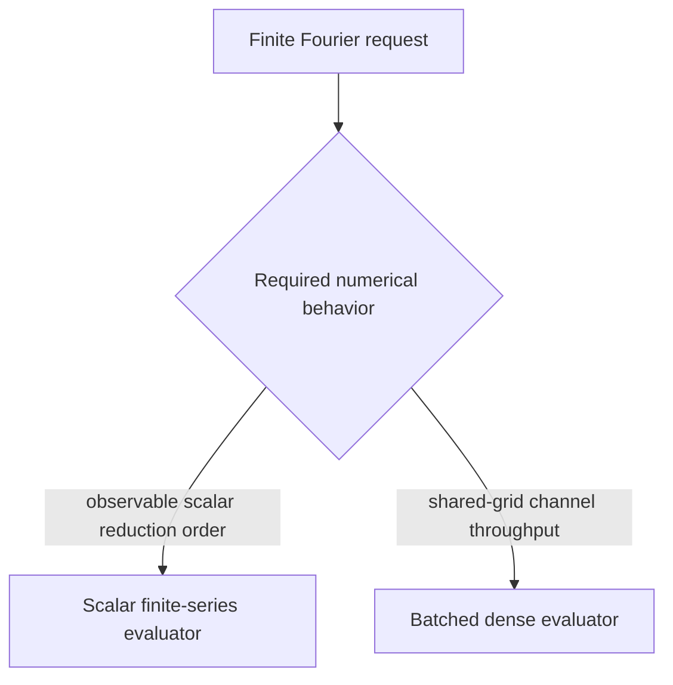

# Shared-grid batched finite Fourier schematics

The diagrams show the dependency-free boundary, shared numerical work, and downstream
ownership separation.

- Public inputs contain no array backend or physics semantics.
- Empty cases return before backend execution.
- Nontrivial channels share one phase matrix and dense reduction.

## Evaluation flow

The public template validates structure before choosing an exact empty result or the
concrete backend path.

- Every nonempty channel shares the same coordinate and mode arrays.
- Backend output is checked again at the nominal boundary.

## Consumer composition

Numerics provides unit-free channels while downstream owners attach their own semantic
records and policies.

- PhysKit maps block entries and truncation families to coefficient channels.
- PhysKit restores model identities, matrices, units, and band records.
- KSD computes scientific error channels and interpretation.

## Scalar distinction

The scalar and batched capabilities share mathematical orientation but make different
floating-point reduction guarantees.

- Scalar evaluation exposes ordered accumulation.
- Batched evaluation exposes dense backend evidence and tolerance-qualified values.

