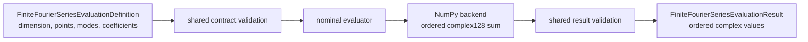
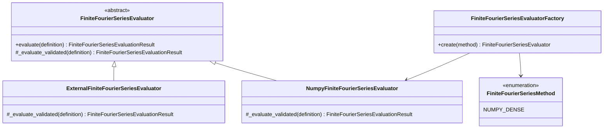
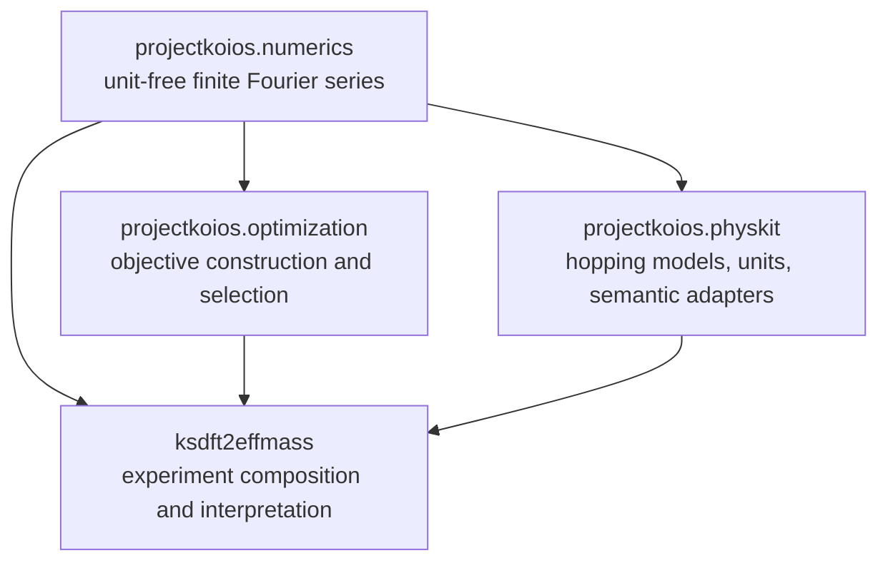
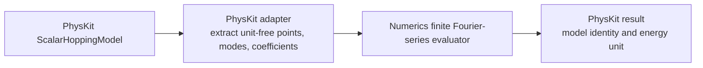
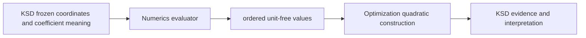
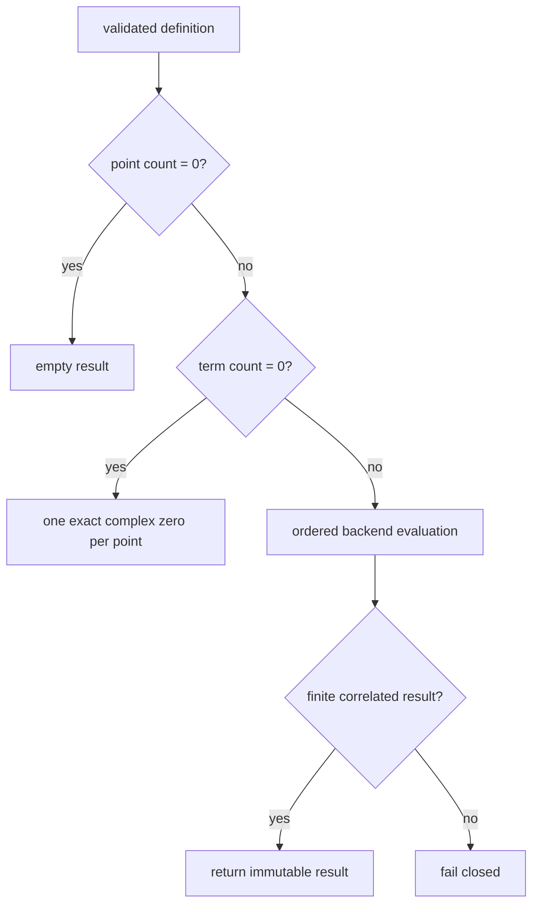

# Finite Fourier-series schematics

## Status

These diagrams describe the current implemented finite-series capability and its
permitted downstream composition. Prospective backends are not shown.

## Evaluation flow

The backend evaluates

$$
y_i=\sum_j c_j\exp\!\left(+2\pi i\,x_i\cdot m_j\right)
$$

without normalization, inference, sorting, or coefficient coalescence.

## Nominal SDK boundary

The factory controls only built-in construction. External implementations use nominal
inheritance and direct injection; they do not mutate the factory.

## Dependency graph

PhysKit is not a required facade. KSD may call the Numerics capability directly when it
already owns the scientific mapping. Numerics imports none of the downstream packages.

## Physics-semantic adaptation

The adapter, not Numerics, owns model identity, basis, energy reference, units,
Hermiticity diagnostics, and physical interpretation.

## KSD composition

The arrows do not authorize KSD to duplicate the Fourier kernel or Optimization to infer
scientific meaning from its numeric inputs.

## Boundary behavior

Empty behavior is part of the public contract. Nonfinite arithmetic and malformed backend
results fail closed rather than returning partial or sanitized values.
