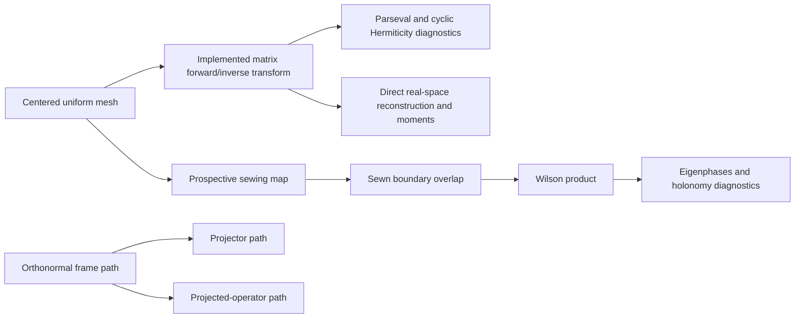
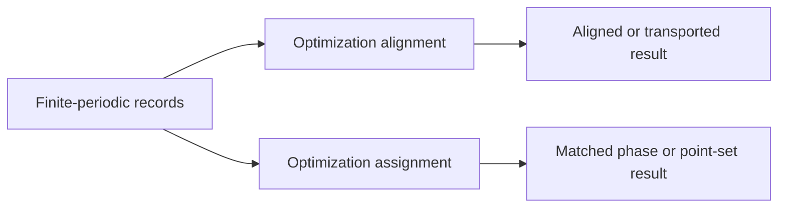
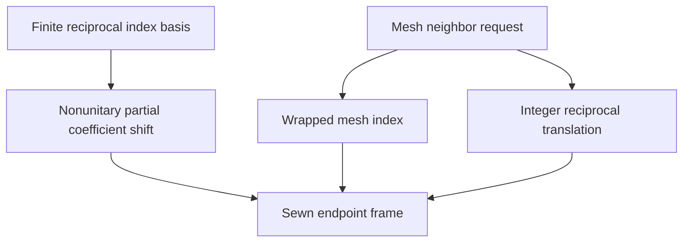

# Finite-periodic schematics

## Representation flow

## Optimization composition

Numerics constructs and evaluates the finite-periodic representation. Optimization
chooses transformations or assignments that optimize declared objectives. Wannier gauge
optimization and localization are not part of either planned ProjectKoios namespace;
they remain Wannier90-owned.

## Sewing distinction

The coefficient sewing map, wrapped mesh index, and integer reciprocal translation are
separate mathematical objects.
