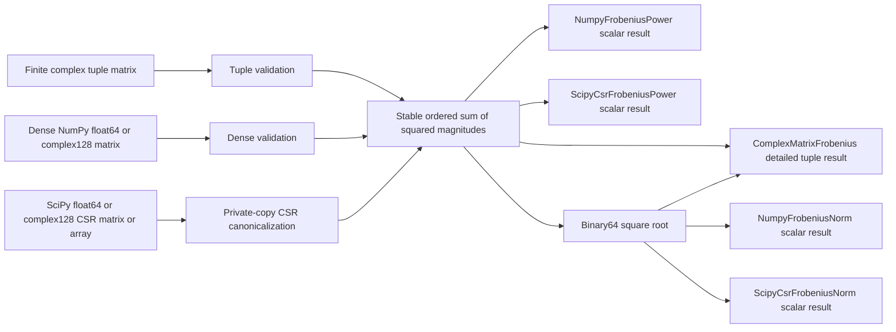

# Frobenius schematics

The dependency-free tuple path retains dimensions, power, and norm in one immutable
record. Optional backend paths expose power and norm as separate unit-free scalar
capabilities. Consumer-owned semantic and unit adapters remain outside Numerics.
