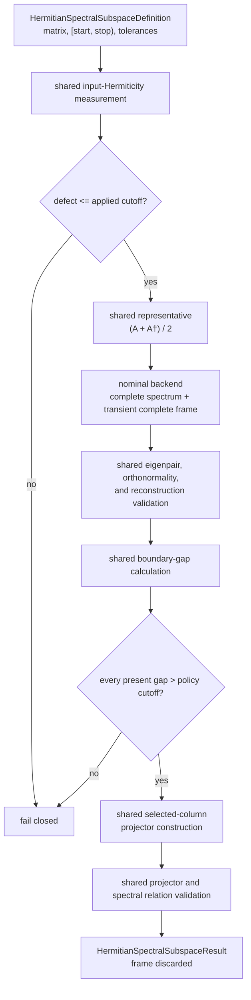
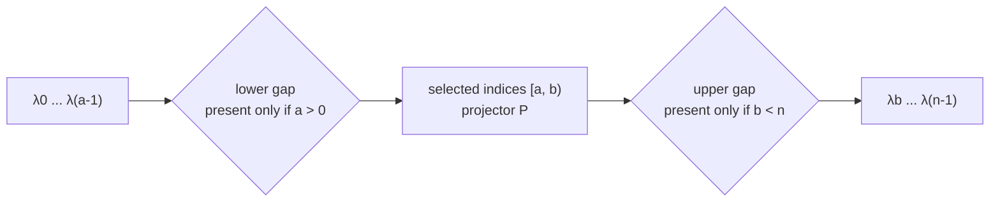
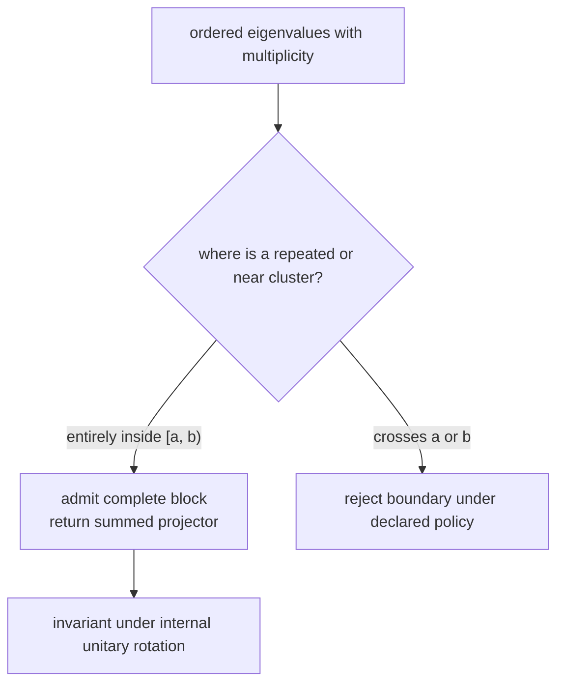
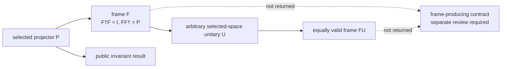
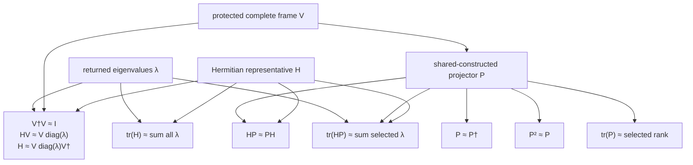
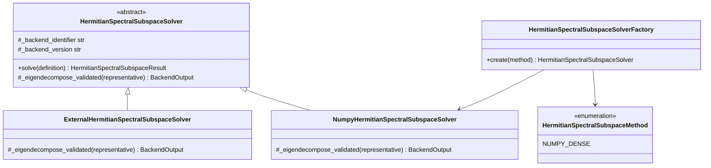
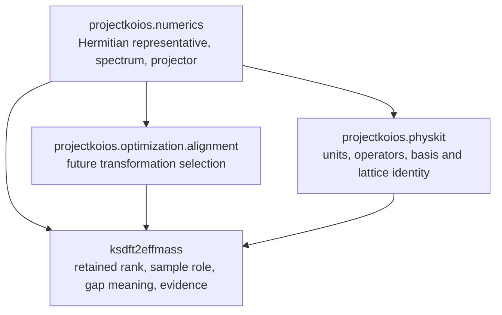
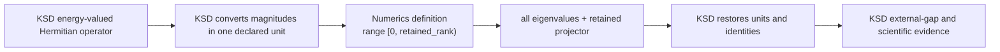
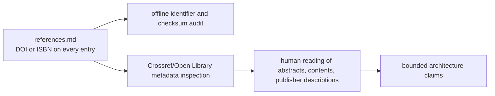

# Hermitian spectral-subspace schematics

## Status

These diagrams describe the proposed invariant-only capability. They do not authorize
source implementation or a frame-producing eigensystem.

## Shared validation and backend flow

The unsymmetrized input is measured before the representative is constructed. The
backend never chooses which input triangle represents the matrix.

## Selected range and optional boundaries

A present boundary passes only when its gap is strictly larger than the applied declared
cutoff. This policy is not itself a backward-error certificate. The lowest group has no
lower boundary. The complete range has neither boundary.

## Internal degeneracy is not a boundary defect

The operation does not split a boundary-degenerate eigenspace and does not reject an
internal degeneracy merely because individual eigenvectors are nonunique.

## Frame nonuniqueness gate

No phase rule, eigenvector ordering within an exact degenerate block, or canonical frame
is implied by the projector result.

## Relational validation

The shared template validates the complete protected eigensystem before it constructs
$P$ from the requested ordered columns. This rejects trace-preserving wrong spectra and
wrong-subspace counterexamples that pass projector-only identities. A backend supplies
no self-authored quality diagnostics.

## Nominal SDK and lazy factory

The factory constructs only reviewed built-ins. External implementations use nominal
inheritance and direct injection.

## Ownership and dependency graph

Numerics imports none of the downstream packages. PhysKit is not a mandatory facade;
KSD may consume the unit-free contract directly when it owns the mapping.

## KSD lowest-group composition

The numerical boundary cutoff and KSD's scientific external-gap lower bound remain
separate controls. Invariant output does not replace M2's still-local eigenframe path.

## Reference and documentation audit

Metadata retrieval helps detect mistaken citations. It does not substitute for reading
the source material or for defining explicit software behavior.
