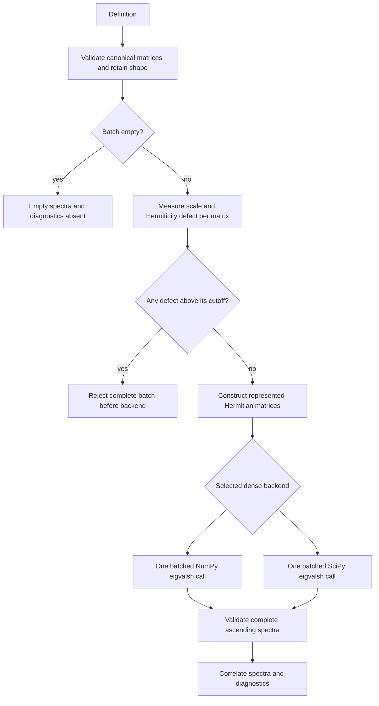
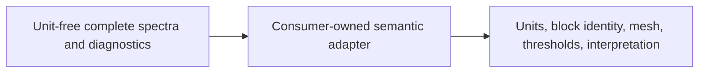

# Batched Hermitian-spectrum schematics

The schematics show evaluation control flow and the boundary between reusable matrix
numerics and consumer-owned semantics.

- Every diagram uses Mermaid.
- Solid arrows represent current data or control flow.
- No diagram introduces eigenvectors, physics, or scientific acceptance policy.

## Evaluation flow

The evaluation flow separates empty construction, represented-input qualification, and
one nonempty batched eigensolver operation.

- Empty definitions return before backend invocation.
- Nonempty definitions fail as a complete batch when any matrix exceeds its own cutoff.
- Accepted matrices retain per-matrix and aggregate diagnostics.

## Ownership flow

The ownership flow keeps physical meaning and scientific decisions outside the numerical
spectrum capability.

- Numerics produces unit-free complete spectra and represented-input evidence.
- Consumer adapters correlate those records with physical objects.
- Consumers own units, block identity, meshes, thresholds, and interpretation.

