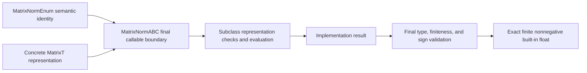

# Matrix-norm contract schematics

Concrete dense NumPy and SciPy CSR Frobenius evaluators and the dense NumPy
maximum-entry evaluator implement this foundation in capability-local backend modules.
Consumers attach units and presentation labels after receiving the unit-free scalar.
