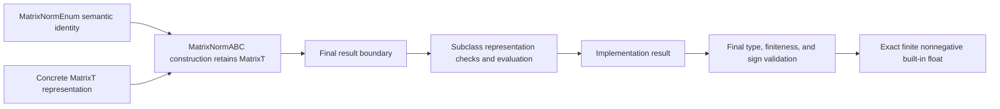

# Matrix-norm contract schematics

Concrete dense NumPy and SciPy CSR Frobenius and maximum-entry evaluations and the dense
NumPy spectral-norm evaluation implement this foundation in capability-local backend
modules. Consumers attach units and presentation labels after receiving the unit-free
scalar.
