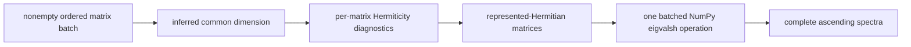
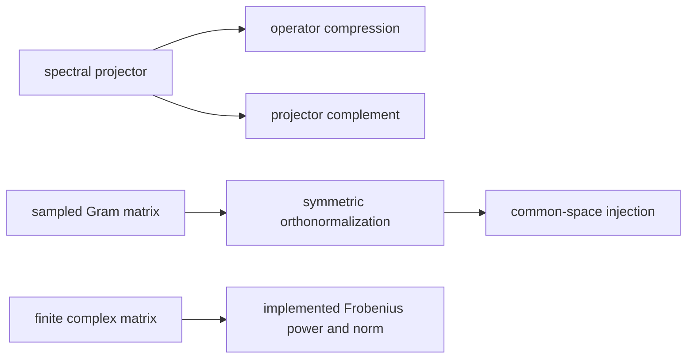
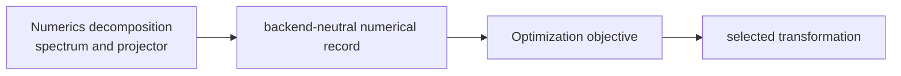

# Linear algebra schematics

## Invariant-first spectral flow

The implemented contract, when authorized, stops at the projector. It does not hide
phase or degenerate-basis choices inside an eigensystem result.

## Batched complete-spectrum flow

An empty batch uses an explicit constructor and returns before the numerical backend,
with aggregate diagnostics absent rather than represented by sentinel maxima.

## Linear-algebra composition

The Frobenius path is current. The projector-complement, compression,
orthonormalization, and injection boxes remain separate prospective capabilities; this
diagram does not authorize them.

## Optimization boundary

The left side belongs to Numerics. The objective and selected optimizer argument belong
to Optimization.

## Consumer semantics

Numerics does not acquire physical units, band meaning, sample roles, or evidentiary
policy merely because a physics or KSD consumer uses the projector.
