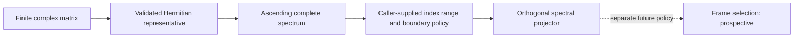
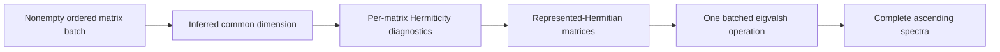
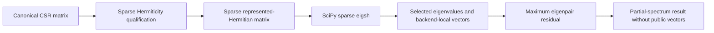
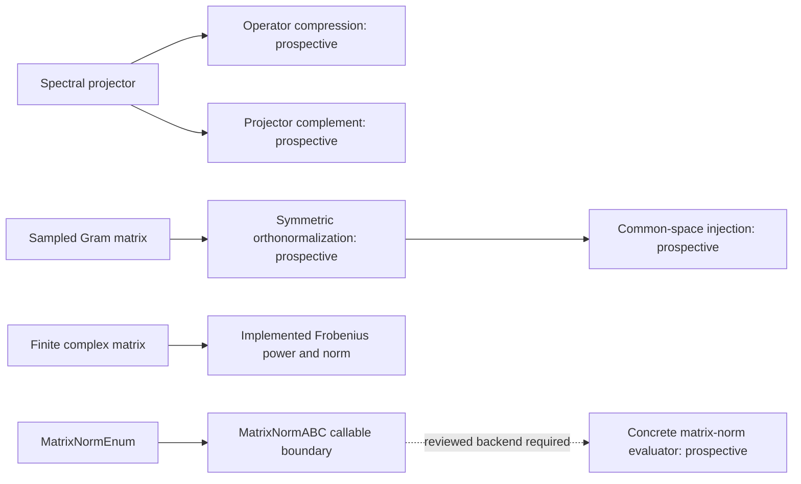
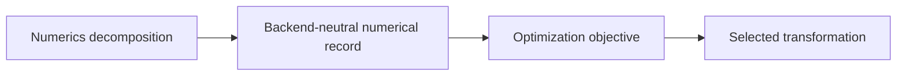
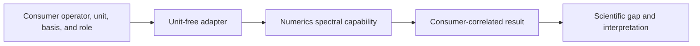

# Linear algebra schematics

The diagrams summarize current invariant-first matrix capabilities and preserve explicit
boundaries around prospective or consumer-owned behavior.

- Every diagram uses Mermaid.
- Current paths use solid arrows.
- Prospective behavior is labeled explicitly and receives no authorization from a
  diagram.

## Invariant-first spectral flow

The spectral-subspace capability returns an invariant projector without choosing a basis
inside the selected subspace.

- The complete spectrum precedes caller-supplied index selection.
- Boundary qualification precedes projector construction.
- Frame selection remains a separate blocked capability.

## Batched complete-spectrum flow

The batched capability infers nonempty shape, measures each input independently, and
executes one batched eigensolver operation.

- Nonempty batches infer dimension from their matrices.
- Empty batches use a named constructor and return before backend invocation.
- Empty aggregate diagnostics remain absent rather than using sentinel maxima.

## Sparse partial-spectrum flow

The sparse capability preserves canonical CSR storage and makes subset selection and
iterative controls explicit.

- Sparse evaluation returns a strict subset rather than claiming a complete spectrum.
- Backend-local eigenvectors support residual evidence without becoming public outputs.
- Consumers decide whether the selected subset is sufficient.

## Linear-algebra composition

The composition view distinguishes implemented reductions from independently reviewed
prospective transformations.

- Frobenius power and norm are current.
- The matrix-norm semantic enum and nominal callable boundary are current; concrete
  backend evaluators remain prospective.
- Projector complement, compression, orthonormalization, and common-space injection are
  prospective.
- Prospective nodes do not inherit acceptance from implemented capabilities.

## Optimization boundary

The ownership boundary distinguishes numerical matrix records from objective-driven
selection of transformations.

- Numerics owns decompositions, spectra, projectors, and backend-neutral evidence.
- Optimization owns objectives and selected optimizer arguments.
- Optimized transport belongs under `projectkoios.optimization.alignment`.

## Consumer semantics

The consumer boundary prevents use by a physics or KSD package from transferring domain
meaning into Numerics.

- Consumers own operators, units, basis identities, and sample roles.
- Numerics owns only unit-free matrix operations and numerical evidence.
- Scientific gap and interpretation policies remain consumer-owned.

