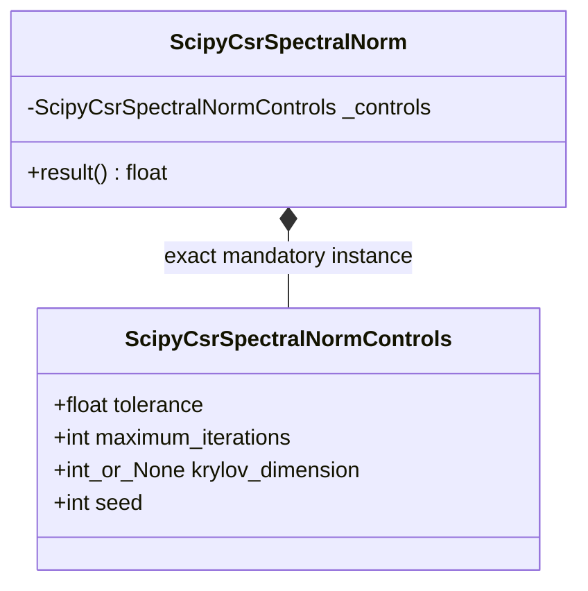

# `ScipyCsrSpectralNormControls` schematics

No evaluator or consumer synthesizes, replaces, or silently ignores the controls record.
The documented direct branch does not consume iterative fields numerically.
