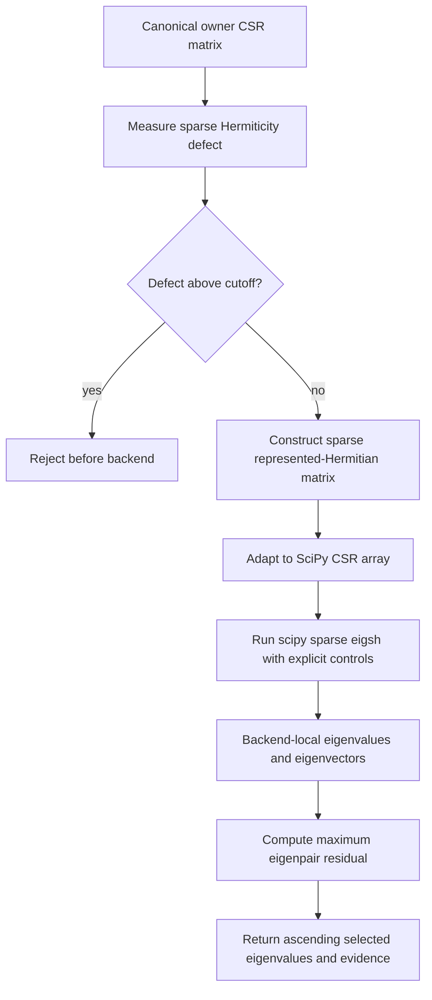
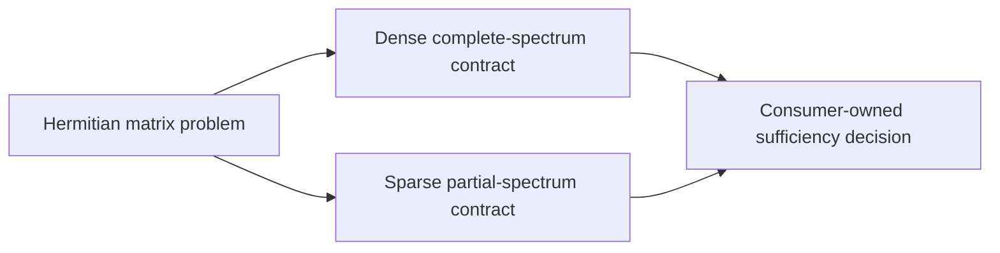

# Sparse partial-spectrum schematics

The diagrams show sparse qualification, partial selection, and the boundary between
backend-local eigenvectors and public invariant evidence.

- Every diagram uses Mermaid.
- Sparse storage remains explicit through backend invocation.
- Public results omit eigenvectors.

## Evaluation flow

The evaluation flow qualifies canonical CSR input before invoking one SciPy ARPACK
problem with explicit controls.

- Hermiticity failure occurs before backend execution.
- The backend computes only the requested strict subset.
- Backend-local vectors produce residual evidence and are then discarded.

## Capability boundary

The capability boundary keeps complete dense spectra and partial sparse spectra as
separate mathematical operations.

- Dense complete evaluation returns every eigenvalue.
- Sparse partial evaluation returns a caller-selected strict subset.
- Consumers choose the operation required by their scientific or physical model.

