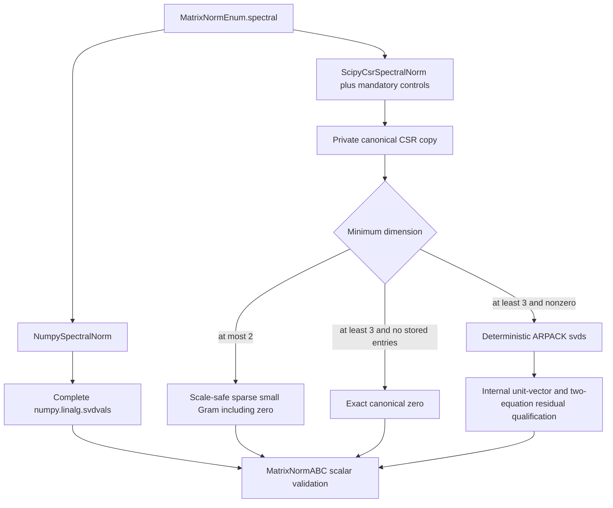
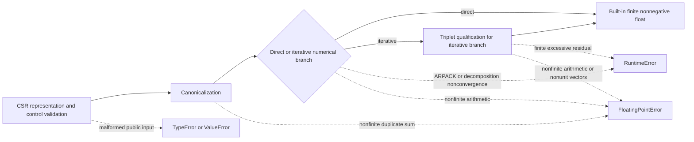

# Matrix spectral-norm schematics

## Implementation selection

## Sparse failure flow

The sparse evaluator has no dense conversion, dense-evaluator delegation, solver
fallback, public residual record, cache, function facade, or implicit controls object.
