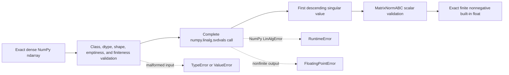

# Dense spectral-norm schematics

The dense path contains no iterative controls, residual record, owner-level scaling,
fallback algorithm, unit handling, or sparse conversion. No sparse spectral-norm
implementation exists. Its iterative contract requires a separate architecture review.
