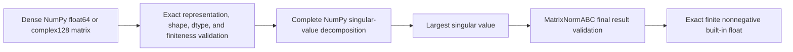

# Dense spectral-norm schematics

The complete dense path has no iterative controls or residual record. Sparse spectral
norms require a separate reviewed architecture and do not inherit this implementation's
acceptance.
