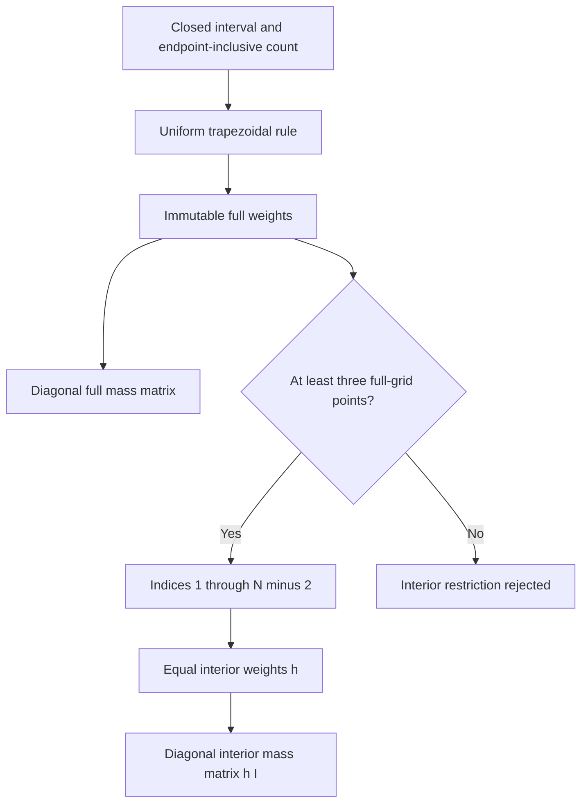
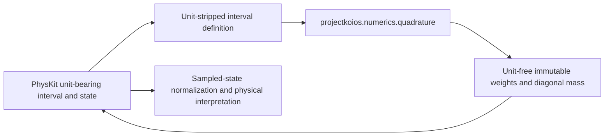

# Uniform one-dimensional quadrature schematics

## Capability flow

## Ownership boundary

Numerics selects no physical unit, boundary-condition model, eigenvector normalization,
or scientific acceptance policy. The homogeneous-Dirichlet operation only declares how
a caller-established zero-endpoint representation restricts the complete quadrature.
