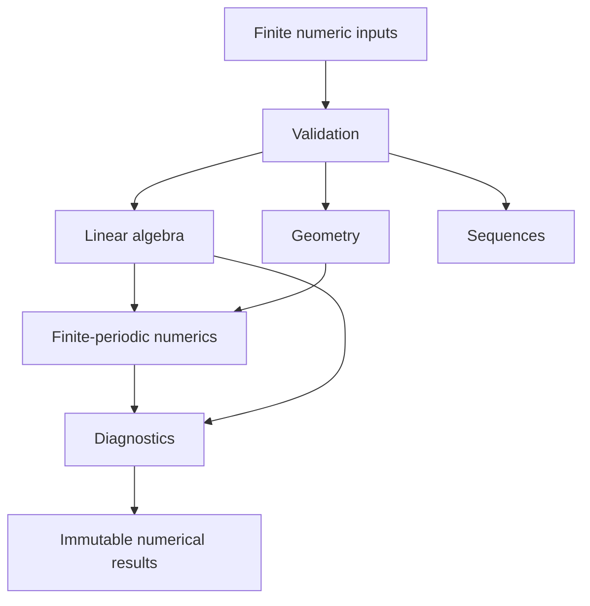
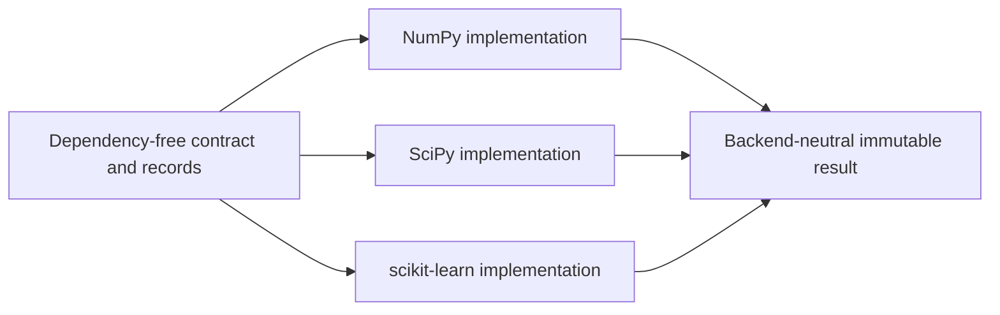
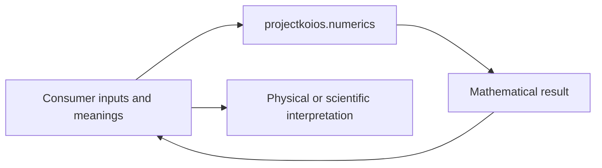

# Numerics schematics

## Capability flow

## Backend composition

Only the selected implementation imports its optional backend.

## Consumer boundary

Numerics returns mathematical state and diagnostics. It does not attach material,
physical, evidentiary, or acceptance meaning.
