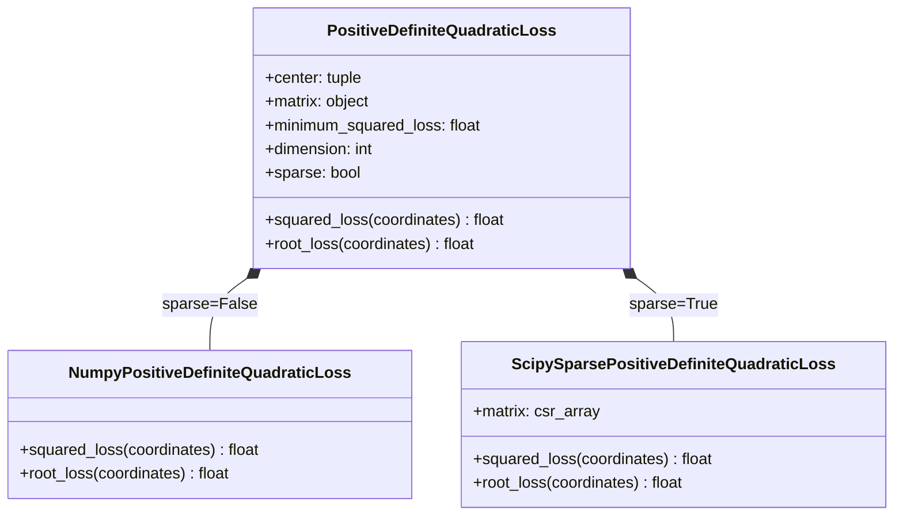
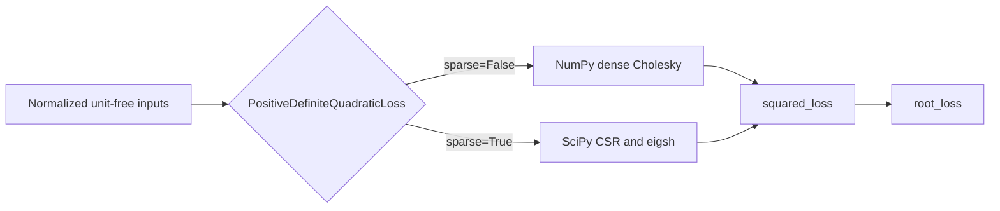

# Schematics

## Object composition

## Call flow

The facade composes exactly one backend object. Backend imports are lazy, so importing
the facade does not import NumPy or SciPy and does not weaken the dependency-free
package root.
