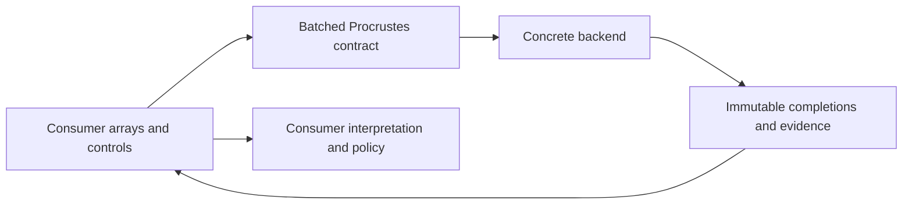
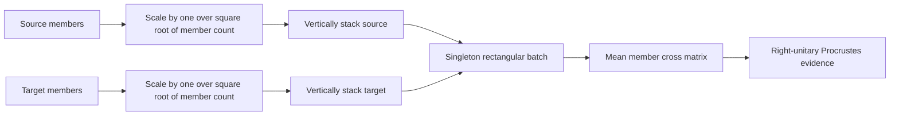
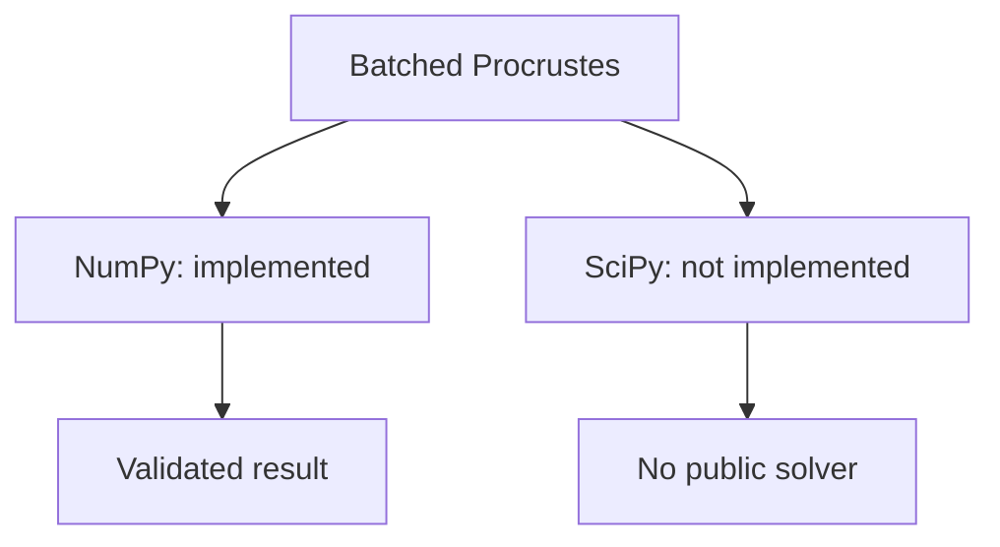

# Batched Procrustes schematics

The capability keeps consumer semantics outside its mathematical and backend boundaries.

A singleton batch can represent one vertically stacked aggregate without changing the
solver contract.

Backend ownership is explicit rather than selected implicitly.

