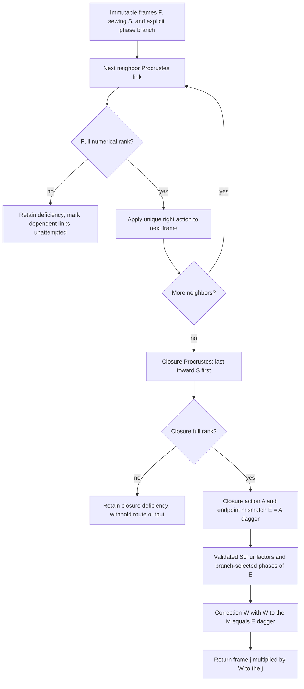

# Closed-loop polar transport schematics

There are exactly `M` edge diagnostics: neighbor indices `0` through `M-2`, followed by
the sewn closure at index `M-1`. Backend decomposition failure raises a typed exception;
rank deficiency remains represented evidence. Phase sorting is deterministic storage,
not a scientific ordering of the phase multiset.
