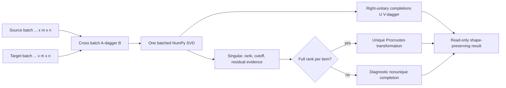
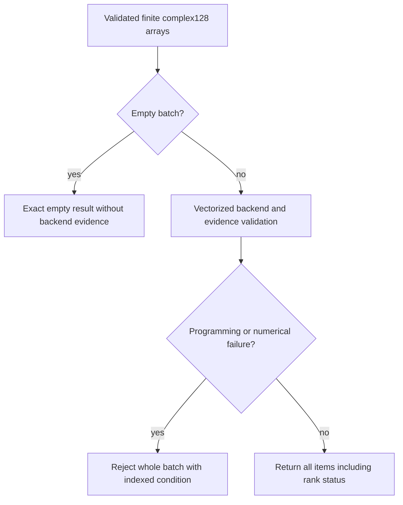
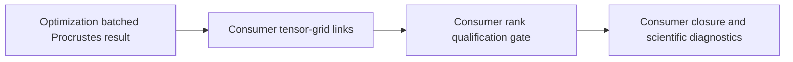

# Batched Procrustes schematics

The diagrams distinguish vectorized numerical work, item-level uniqueness status, and
downstream interpretation.

- One phase of array validation precedes backend execution.
- One public SVD handles every nonempty batch item.
- Every item retains its own rank and residual evidence.

## Vectorized solve

The solver preserves all leading dimensions through cross construction, decomposition,
and result assembly.

- Full-rank and deficient items share one homogeneous array result.
- Deficient completions remain explicitly nonunique diagnostics.

## Failure boundary

The batch has an all-or-nothing failure policy for invalid arithmetic while rank
deficiency is ordinary per-item evidence.

- Validation reports the first failing leading index in C order.
- No partial result escapes a failed solve.

## Consumer boundary

Optimization supplies selected completions and numerical evidence without deciding their
scientific use.

- Consumers may admit only full-rank transformations.
- Consumers may retain deficient completions for diagnostics only.

