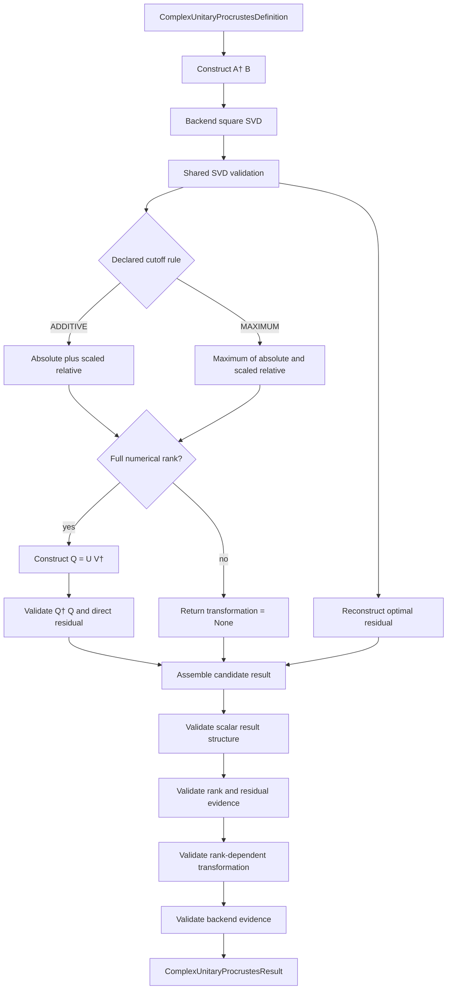

# Procrustes schematics

Transient backend null-space vectors may occur inside a complete SVD, but they are not
used to construct or expose a deficient full transformation.

## Batched distinction

The NumPy batch capability preserves homogeneous array shape while making uniqueness a
separate per-item status.

- Full-rank items expose unique right transformations.
- Deficient items expose diagnostic SVD completions marked non-full-rank.
- See the [batched schematics](../batched_procrustes/schematics.md) for vectorized flow.
