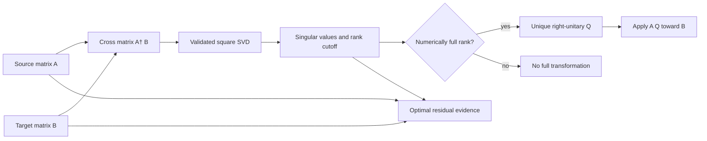

# Alignment schematics

## One-pair right alignment

The deficient branch deliberately does not use the SVD's arbitrary null-space bases to
construct a public unitary completion. Path ordering, closure, and frame interpretation
remain outside this capability.
