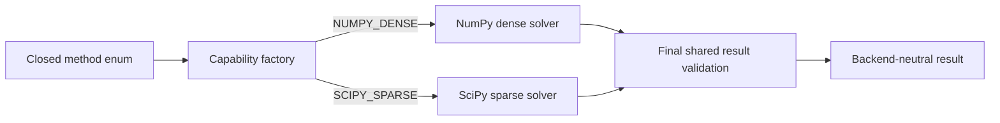
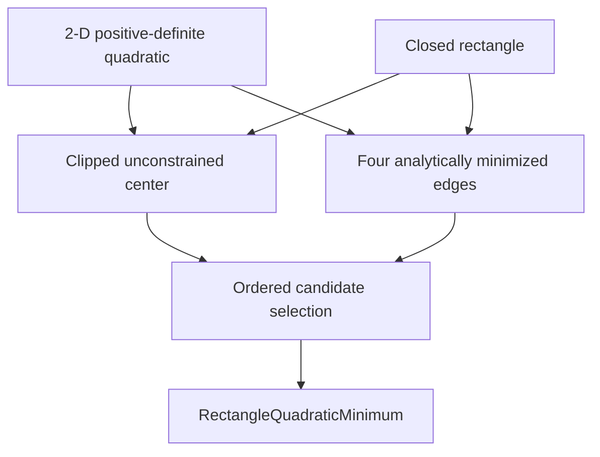
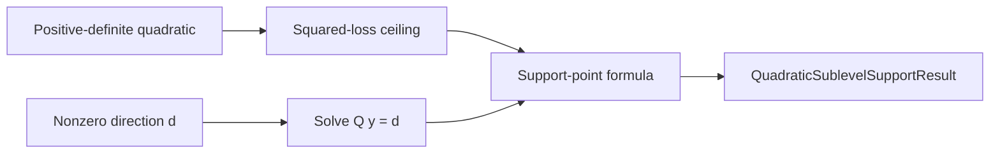
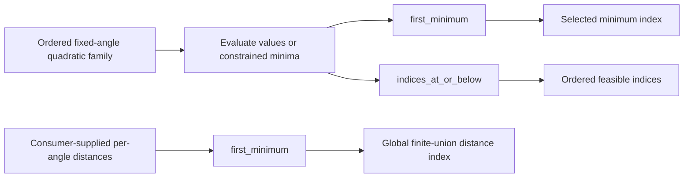

# Constrained-quadratic schematics

## Solver construction

## Rectangle minimization

Candidate order is the clipped center, coordinate-0 lower edge, coordinate-0 upper edge,
coordinate-1 lower edge, and coordinate-1 upper edge. Exact ties retain the earliest
candidate.

## Ellipsoid support

The operation optimizes the directional linear functional over the full quadratic
sublevel ellipsoid. Box containment remains a consumer check.

## Finite family

The nonconvexity is only a finite union. Complete ordered enumeration reduces the global
comparison to the minimum of per-member values. This capability does not calculate a
general distance between box-clipped sublevel sets.
