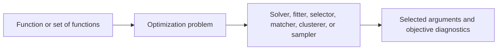
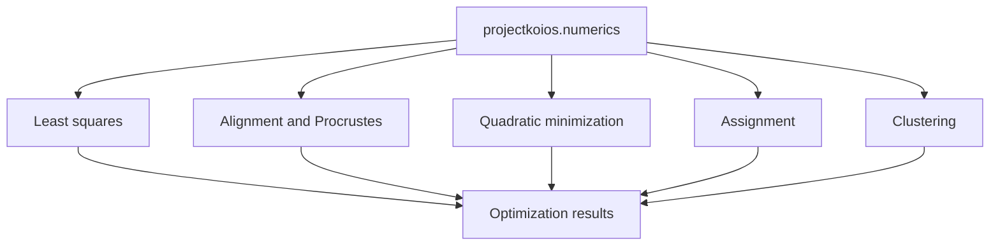
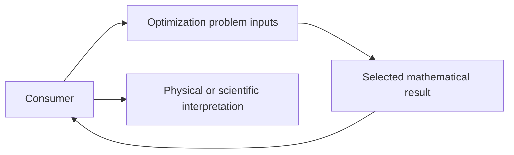

# Optimization schematics

## Objective-based ownership

## Capability composition

## Consumer boundary

Optimization owns objective definitions and selection behavior. Consumers own physical
meaning, units, scientific thresholds, and acceptance.
