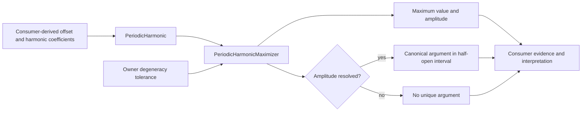
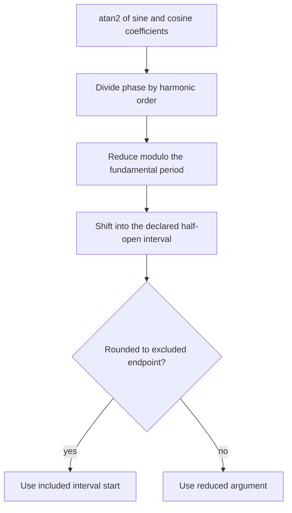

# Periodic harmonic schematics

## Ownership flow

## Canonicalization

The owner selects only a numeric periodic argument. Coefficient construction and all
scientific labels remain outside the capability.
