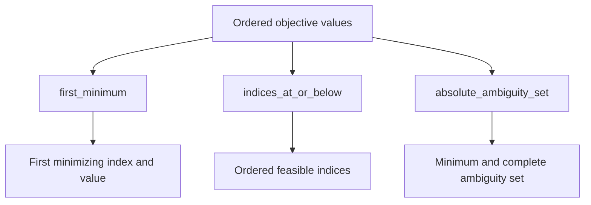
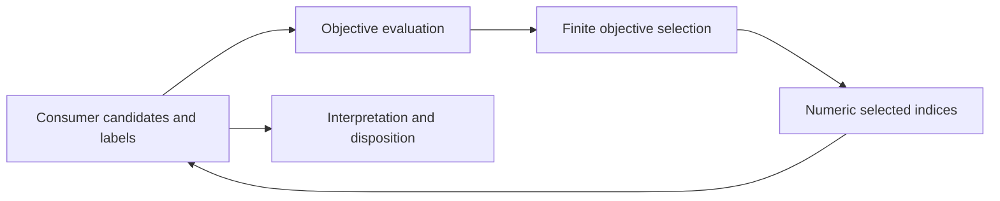
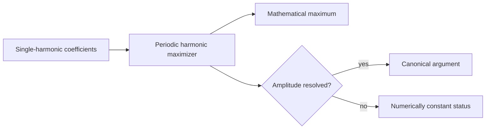

# Selection schematics

## Selection operations

## Consumer composition

Selection never stores consumer labels or assigns scientific meaning to ceilings and
tolerances.

## Closed-form continuous selection

Only the explicitly supported single-harmonic family uses this continuous route. It is
not a generic continuous optimizer.
