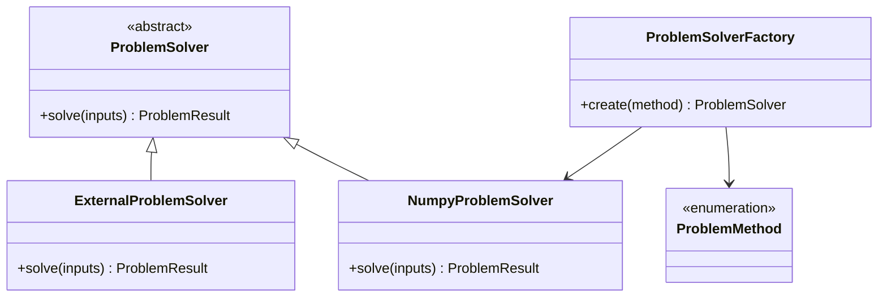
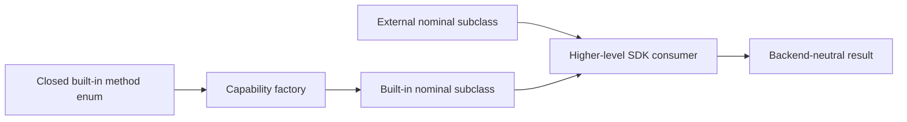
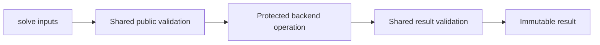

# Solver-template schematics

## Nominal SDK boundary

## Construction and injection

The factory controls built-in construction. The abstract class controls nominal SDK
substitution.

## Template-method validation

A capability can place shared invariant enforcement in the abstract class and delegate
only backend-specific numerical work to a protected abstract operation.
